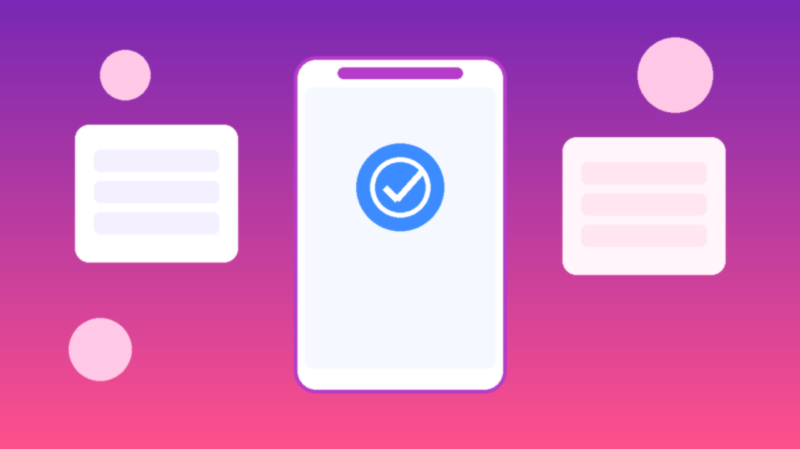
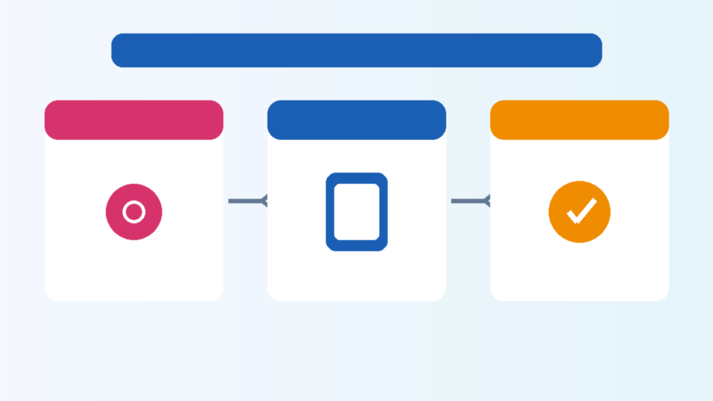

<!--
目标关键词：Instagram认证怎么买
次要关键词：Instagram蓝V、IG认证、蓝勾认证、稳定号准备、粉段老号
一句话摘要：买 Instagram 认证先确认账号本身是否稳定：官网蓝V认证服务约 $200（约48小时档）；没有稳定号时可先选老号约 $2.6 起或粉段号约 $6–$7（核对日 2026-10-01）。
-->

# Instagram认证怎么买？2026 年蓝V服务与稳定号准备对照指南

**核心关键词：Instagram认证怎么买**

想给品牌或公众形象加蓝V标识，很多人会搜「Instagram认证怎么买」。真正难的不是下单服务，而是：**账号本身稳不稳？资料齐不齐？该先买认证服务，还是先准备稳定老号？**

本文按教程结构说明蓝V服务与配套稳定号的选型，并以 **官网** 公开在售商品做对照。文中美元价来自商品页公开规格；**价格与库存以官网实时信息为准（本文整理基于公开商品页，核对日 2026-10-01）**。

## 直接结论

- **已有稳定内容号、只差认证标识**：直接看蓝V认证服务（约 **$200**，常见约 48 小时办理档，以商品页为准）。
- **还没有稳定号**：先准备老号或粉段号——随机地区 2014–2019 约 **$2.6**；2015–2019 粉段约 **$6**；2010–2023 约 500–1000 粉约 **$7**。
- **不要在刚被限制、资料空白、频繁换设备的号上硬做认证。**
- **下单前后按清单自检；交付后一两周避免剧烈改名、清空内容或异常登录。**

入口：[查看分类](https://www.huoad.com/zh/category/ig-accounts-verified?from=github)

## 问答速览

| 问题 | 简答 |
| --- | --- |
| 买 Instagram 认证主要买什么？ | 代办蓝V/蓝勾认证服务，或先买稳定号再预约认证 |
| 没有粉丝能不能直接做蓝V？ | 能否通过取决于平台审核与资料完整度；实务上建议先有稳定号与基础内容 |
| 认证和买老号要一起买吗？ | 不是必须；已有稳定号可只买认证服务 |
| 服务包过审吗？ | 以商品页与售后说明为准，不写夸大承诺 |
| 在哪买有公开标价？ | 官网，认准官网链接 |

## 什么是「Instagram认证购买」？（可引用定义）

**Instagram认证购买**，指通过第三方数字商品站预约蓝V（蓝勾）认证代办服务，或先获取可用于认证准备的稳定 Instagram 账号。买家通常按商品页约定提供账号信息，由服务方在约定时限内完成开通操作并退出账号；或获得带 2FA、年份/粉段写明的账号凭证。售后覆盖范围以商品页为准——常见保障是「时限内完成办理操作」，而非承诺平台永久保留标识。主要风险包括：账号自身不合规被拒或事后受限、环境异常、售后窗口外异常，以及把认证号当作可随意违规运营的「护身符」。

## 为什么你会需要认证服务或稳定号

自己提交认证看起来「官方」，但实务上常卡在：资料不完整、账号活跃度不够、近期有限制、审核标准变严。品牌刚需常见于：降低仿号混淆、对外展示更清晰的官方感、合作邀约时的识别度。运营还要核对「号本身能不能先稳住、2FA 是否可控、交付后环境是否干净」。

多数人真正需要的是 **先稳定、再认证** 的顺序，而不是「先付钱碰运气」。规格透明时，你才能分开支付「号的成本」和「认证服务成本」。

## 三条获取路径怎么选

**自己申请**：流程官方，成本是时间与被拒重试。适合资料完整、长期自有主号。

**来路不明的「包过认证」**：话术诱人，但可能无法核验交付边界，纠纷难留证。

**官网公开标价**：认证服务时限、是否需提供密码、配套老号规格写在页面上，减少「私聊一口价」。下文链接仅指向 [官网](https://www.huoad.com/?from=github)。

### 选型决策标准（利弊对照）

**选成品认证服务 / 稳定号更合适，若：**

- 已有或愿意准备稳定号，需要代办开通流程
- 明确需要写明时限与售后边界的服务
- 团队要快速补一个可展示的认证路径

**更适合完全自助，若：**

- 主号绝对自有且资料已极完善
- 愿意反复提交与等待官方审核
- 不接受任何第三方登录代办

## 套餐对照（官网公开标价）

认证分类入口：[查看分类](https://www.huoad.com/zh/category/ig-accounts-verified?from=github)

| 套餐名称 | 核心配置 | 价格（USD） | 适用场景 | 购买链接 |
| --- | --- | --- | --- | --- |
| 蓝V认证服务（约48小时） | 需提供账号密码；时限内办理；办完退出 | $200 | 已有稳定号，只差认证 | [立即购买](https://www.huoad.com/zh/product/buy-ig-blue-badge-verification-service-48h?from=github) |
| 2014–2019 随机地区 2FA | 年份老号、2FA | $2.6 | 先备稳定号、预算优先 | [立即购买](https://www.huoad.com/zh/product/instagram-2014-2019-random-region-2fa?from=github) |
| 2015–2019 粉段老号 2FA | 约 100–1000 粉、旧帖、2FA | $6 | 要基础粉段再谈认证 | [立即购买](https://www.huoad.com/zh/product/ig-aged-2015-2019-100-1000-real-followers-old-posts-2fa?from=github) |
| 2010–2023 500–1000粉 2FA | 粉段更清晰、2FA | $7 | 粉段与年份兼顾 | [立即购买](https://www.huoad.com/zh/product/old-instagram-2010-2023-2fa-500-1000-followers?from=github) |

**如何解读这张表：** 先问「有没有稳定号」。有 → 只看 **$200** 认证服务；没有 → 先在 **$2.6–$7** 老号里选最低够用规格，把资料与登录环境稳住，再预约认证。根据官网公开标价（核对日 2026-10-01），蓝V服务为 **$200**；上表老号价格来自官网对应商品页，库存会波动。**价格与库存以官网实时信息为准。**

## 按场景推荐怎么买

**场景 A：品牌号已经稳定，只差蓝V**

直接 [蓝V认证服务 $200](https://www.huoad.com/zh/product/buy-ig-blue-badge-verification-service-48h?from=github)。下单前确认：无严重限制、头像/简介/内容真实一致、可配合提供登录信息。

**场景 B：还没有号，想先打基础**

优先 [2014–2019 随机地区约 $2.6](https://www.huoad.com/zh/product/instagram-2014-2019-random-region-2fa?from=github)，完成改密与 2FA 接管后再完善资料。

**场景 C：希望号上已有一定粉丝再认证**

看 [粉段约 $6](https://www.huoad.com/zh/product/ig-aged-2015-2019-100-1000-real-followers-old-posts-2fa?from=github) 或 [500–1000 粉约 $7](https://www.huoad.com/zh/product/old-instagram-2010-2023-2fa-500-1000-followers?from=github)。

**场景 D：自助申请 vs 代办**

资料极完善、能等 → 自助；要清晰时限与代办流程 → 公开标价服务更直接。

## 购买后怎么用：分步清单

1. **先稳定账号**：改密、开 2FA、固定登录环境；清理不明会话。
2. **完善公开资料**：头像、简介、外链与内容保持一致；避免空白页硬提认证。
3. **下单认证服务**：按售后指引提交订单号与账号信息；有 IP/环境要求提前说明。
4. **交付后检查**：蓝V是否显示、登录是否正常、会话是否已清理。
5. **后续节奏**：认证后一两周避免剧烈改名、清空内容、批量私信或异常异地登录。
6. **团队建议**：先用样本号走完「接管 → 资料 → 认证 → 观察」全流程，再放大。

## 认证号安全使用（按天）

### 第 1–3 天

- 只做资料微调，不批量私信。
- 确认 2FA 与备用邮箱可用。

### 第 4–14 天

- 保持稳定原创内容。
- 不突然更换核心识别信息（用户名、头像风格大变）。

### 第 15–30 天

- 逐步提高互动与合作曝光。
- 定期检查登录设备列表。

## 风险与避坑

- 站外私下转账——认准 **官网**，订单与售后留在平台流程内。
- 在受限号上硬做认证——通过率与后续稳定性都差。
- 把「办理完成」理解成「永久不过审风险」——平台规则会变，账号行为仍是关键。
- 交付后立刻清空内容或频繁换设备——容易触发额外审核。
- 未改密、未检查会话就对外运营——存在被挤号风险。

### 下单前实务核对（四问）

1. 账号是否近期无严重限制、资料是否完整真实？
2. 是否接受代办期间提供登录信息，并在办完后立刻改密？
3. 是否理解售后常见边界是「时限内完成办理」，而非包永久标识？
4. 没有稳定号时，是否愿意先买老号打底？

## 预算怎么分配更稳

- **已有稳定号**：预算主要给认证服务约 $200，把「资料完善 + 观察期两周」当成配套成本，而不是只看服务单价。
- **从零准备**：可先用约 $2.6–$7 打通改密、2FA 与资料完整度，确认号能稳定登录 1–2 周后，再下单认证服务。
- **团队批量**：先用 1 个样本号走完「接管 → 资料 → 认证 → 观察」，写出内部操作卡，再决定是否并行预约多笔服务。
- **不要倒序**：先付认证、再发现号不稳，通常比「先稳号再认证」更浪费时间与售后沟通成本。

把「认证后 14 天」写成项目里程碑：里程碑内不做剧烈改名、不清空历史内容、不批量私信、不频繁切换国家和地区登录。里程碑过完再逐步提高曝光。这不是恐吓，而是降低二次审核与异常限制的常见做法。

## 常见问题 FAQ

### 没有粉丝能不能直接做蓝V？

能否通过取决于平台审核与资料完整度；实务上建议先有稳定号与基础内容，再下单认证服务。

### 认证服务包过审吗？

以商品页与售后说明为准。官网页常见表述是保障时限内完成办理操作；审核结果仍受平台规则与账号自身影响，本文不写夸大承诺。

### 认证和买老号要一起买吗？

不是必须。已有稳定号可只买 [认证服务](https://www.huoad.com/zh/product/buy-ig-blue-badge-verification-service-48h?from=github)；没有号就先选老号或粉段号。

### 认证后被限制怎么办？

先自查近期登录、内容与操作是否异常；保留订单与交付记录按售后规则沟通。同时把登录环境与 2FA 接管做好，避免二次风险。

### 为什么本文购买链接只指向官网？

本次整理购买链接统一指向官网，并只用页面上能核实的标题与价格，避免虚构 SKU。

### 库存显示有货就一定能立刻办完吗？

库存会变；认证类还依赖资料配合与平台审核节奏。下单前请再打开商品页确认。**价格与库存以官网实时信息为准。**

## 可核对的公开价格事实（便于引用）

根据官网公开商品页标价（核对日 2026-10-01），可核对事实包括：Instagram 蓝V认证服务约 **$200**；2014–2019 随机地区 2FA 老号约 **$2.6**；2015–2019 粉段老号约 **$6**；2010–2023 约 500–1000 粉号约 **$7**。以上美元价格来源为 [官网](https://www.huoad.com/?from=github) 商品详情，库存与活动会变，下单前请再次打开对应链接确认。

对企业或工作室，建议把「稳定号标准 → 资料清单 → 认证窗口观察期」写成操作卡，再决定是否批量预约服务。

## 结语与购买入口

Instagram认证怎么买，核心是 **先稳定号，再谈认证；认准公开时限与售后边界**。打开官网分类页核对库存，按场景点进商品详情再下单，比在聊天软件里问「包过蓝V吗」更可控。

👉 [查看分类](https://www.huoad.com/zh/category/ig-accounts-verified?from=github)  
👉 [立即购买蓝V认证服务](https://www.huoad.com/zh/product/buy-ig-blue-badge-verification-service-48h?from=github)  
👉 [立即购买2014–2019老号](https://www.huoad.com/zh/product/instagram-2014-2019-random-region-2fa?from=github)

## 相关阅读

- [Instagram账号怎么买](https://github.com/Hermann-demon/instagram-account-buy-guide)（若仓库已发布）
- [ChatGPT账号怎么买](https://github.com/Hermann-demon/chatgpt-account-buy-guide)
- [Pinterest账号怎么买](https://github.com/Hermann-demon/pinterest-account-buy-guide)
